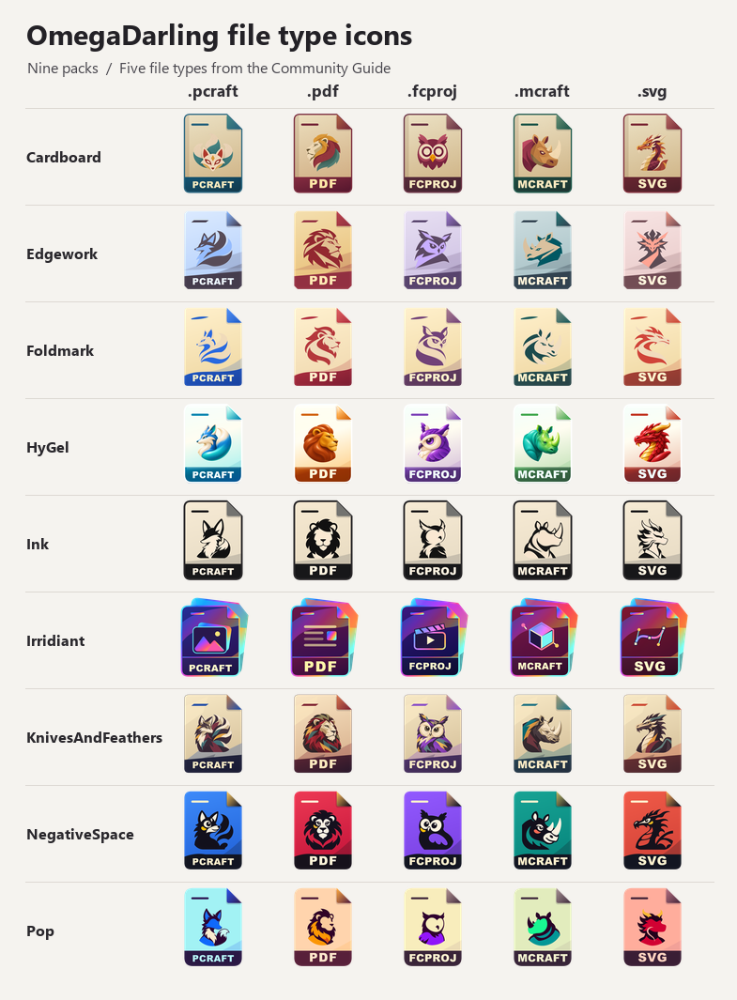

# OmegaDarling icon themes

Nine themes with 20 icons each, including ArtCraft Launcher.

| Theme | Example sheet |
| --- | --- |
| [Cardboard](Cardboard/) | [Preview](8.%20Cardboard.png) |
| [Edgework](Edgework/) | [Preview](3.%20Edgework.png) |
| [Foldmark](Foldmark/) | [Preview](4.%20Foldmark.png) |
| [HyGel](HyGel/) | [Preview](1.%20HyGel.png) |
| [Ink](Ink/) | [Preview](Ink.png) |
| [Irridiant](Irridiant/) | [Preview](2.%20Irridiant.png) |
| [KnivesAndFeathers](KnivesAndFeathers/) | [Preview](5.%20KnivesAndFeathers.png) |
| [NegativeSpace](NegativeSpace/) | [Preview](7.%20NegativeSpace.png) |
| [Pop](Pop/) | [Preview](Pop.png) |

Edgework and Foldmark include editable SVG sources and approved full-resolution PNGs. BetterIcon 1.26.3 downloads the 20 recognized app icons in each theme as SVG. The other themes use full-resolution PNGs. CADCraft uses the ant mascot in every theme.

- Edgework [SVG sources](Edgework/svg/) and [PNG exports](Edgework/png/)
- Foldmark [SVG sources](Foldmark/svg/) and [PNG exports](Foldmark/png/)

## File type icon packs

Each pack contains the Community Guide’s 37 file icons, covering 96 extensions across 17 ArtCraft apps. Eight packs use the app mascot on a folded page. Irridiant uses a symbol for each format.

Download one ZIP and import it in BetterIcon’s pack manager. Select the imported pack under **File type icon pack**. BetterIcon 1.28.0 recognizes all 37 designs. The 1.26.3 release recognizes 13 of the lead filenames.

| File type pack | Import ZIP | Editable SVGs |
| --- | --- | --- |
| [Cardboard](Cardboard_filetypes/) | [Download Cardboard](Cardboard_filetypes/Cardboard_filetypes.zip?raw=1) | — |
| [Edgework](Edgework_filetypes/) | [Download Edgework](Edgework_filetypes/Edgework_filetypes.zip?raw=1) | [37 SVGs](Edgework_filetypes/svg/FileTypes/) |
| [Foldmark](Foldmark_filetypes/) | [Download Foldmark](Foldmark_filetypes/Foldmark_filetypes.zip?raw=1) | [37 SVGs](Foldmark_filetypes/svg/FileTypes/) |
| [HyGel](HyGel_filetypes/) | [Download HyGel](HyGel_filetypes/HyGel_filetypes.zip?raw=1) | — |
| [Ink](Ink_filetypes/) | [Download Ink](Ink_filetypes/Ink_filetypes.zip?raw=1) | [37 SVGs](Ink_filetypes/svg/FileTypes/) |
| [Irridiant](Irridiant_filetypes/) | [Download Irridiant](Irridiant_filetypes/Irridiant_filetypes.zip?raw=1) | [37 SVGs](Irridiant_filetypes/svg/FileTypes/) |
| [KnivesAndFeathers](KnivesAndFeathers_filetypes/) | [Download KnivesAndFeathers](KnivesAndFeathers_filetypes/KnivesAndFeathers_filetypes.zip?raw=1) | [37 SVGs](KnivesAndFeathers_filetypes/svg/FileTypes/) |
| [NegativeSpace](NegativeSpace_filetypes/) | [Download NegativeSpace](NegativeSpace_filetypes/NegativeSpace_filetypes.zip?raw=1) | [37 SVGs](NegativeSpace_filetypes/svg/FileTypes/) |
| [Pop](Pop_filetypes/) | [Download Pop](Pop_filetypes/Pop_filetypes.zip?raw=1) | [37 SVGs](Pop_filetypes/svg/FileTypes/) |

Each ZIP includes pack metadata and 37 transparent 1024 × 1024 PNGs in `FileTypes/`. Extensions in the same guide entry share an icon. For example, `dxf.png` covers both `.dxf` and `.dwg`.

Artwork by **OmegaDarling**, distributed under the repository's [MIT license](../LICENSE).
