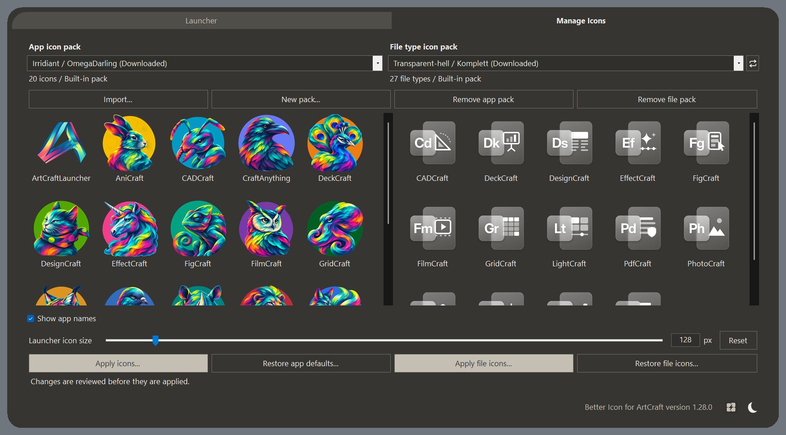
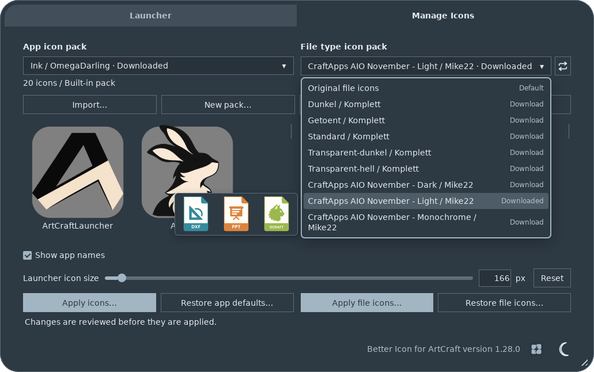
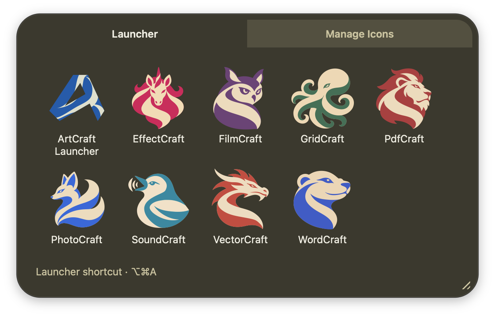

# BetterIcon for ArtCraft

Launch your installed ArtCraft apps from the Windows or Linux system tray or the macOS menu bar. Give your apps and their files different looks with independent icon packs.

**[Download BetterIcon for Windows, macOS, or Linux](https://github.com/BinziiBinzet/bettericon-craft-apps/releases/latest)**

The screenshots and features below are from **BetterIcon 1.28.0**. For designing and sharing artwork, start with the [Community Guide PDF](#make-an-icon-pack).

## BetterIcon in action

### Pick separate app and file type icons

Open **Manage Icons** and choose an **App icon pack** and a **File type icon pack**. The two previews sit side by side. Choose **Apply icons…** or **Apply file icons…** to review and apply the artwork. Use **Restore app defaults…** and **Restore file icons…** to undo either change independently.

*Windows Manage Icons with Irridiant by OmegaDarling and Transparent-hell by Komplett.*

### Customize the icons for your files

BetterIcon 1.28.0 recognizes **37 file icon designs** across native ArtCraft projects and groups of related formats. A pack can give PhotoCraft projects (`.pcraft`) their own icon, use one design for Photoshop documents (`.psd` and `.psb`), or give PDFs a separate icon. Coverage depends on the pack you choose. BetterIcon leaves your default apps in place.

- **Windows** applies icons to registered file types in File Explorer. Extensions that share a Windows file class can share an icon.
- **Linux** applies icons to MIME types for your user account. In GNOME Files, press **F5** to refresh a window that was already open. File managers may continue to show thumbnails for files they can preview.
- **macOS** applies custom Finder icons to the files you choose. Select a folder to cover matching files in it and its subfolders. BetterIcon applies the pack to new matching files while it runs and catches up at the next start. Restore a folder to remove its BetterIcon file icons and stop watching it.

On Windows and Linux, BetterIcon generally themes common formats like PDF when an ArtCraft app is their default opener. The preview before applying shows which types qualify.

*Linux preview of the Light edition of Mike22’s CraftApps AIO November file type pack.*

### Preview packs before downloading

Hover over a name in either picker to see up to three sample icons. **Download**, **Downloaded**, and **Update available** show the status of each pack. Select a pack to download or update its artwork. Click the refresh button beside the pickers to check for catalog changes. The 1.28.0 installers include the catalog and its preview strips, and keep downloaded packs available offline.

### Launch apps with one click

Open **Launcher** from the tray or menu bar, or use the configurable keyboard shortcut. Click an app to open it, or type part of its name and press **Enter** or **Return**. The icon brightens when you hover over it or select it with the keyboard. Launcher shows the last applied app pack, with ArtCraft Launcher first when installed. The two tabs remember their window sizes separately. You can also change icon size, show or hide app names, and choose BetterIcon’s own icon and light or dark appearance.

*macOS Launcher with Foldmark by OmegaDarling.*

## How to Run

Get the package for your system from [GitHub Releases](https://github.com/BinziiBinzet/bettericon-craft-apps/releases). Starting with 1.28.0, each platform has one installer and downloads pack artwork as you choose it.

### Linux

- Extract the graphical Linux package and run `./install.sh` to add **BetterIcon for ArtCraft** to Applications and the system tray. [Linux guide](Linux/README.md)
- The original terminal installer, `Linux/install.sh`, reports which apps it finds and backs up their desktop entries. Run `Linux/uninstall.sh` to restore them.

### Windows

- Run Windows Setup to add BetterIcon and its Start menu shortcut. Click the tray icon to open or close the popup. A source checkout also includes `Windows/Start-Tray.cmd`.
- Shared shortcuts can require administrator access to apply or restore their icons. The command-line installers remain available as `Windows/Install-Windows.cmd` and `Windows/Restore-Windows.cmd`. [Windows guide](Windows/WINDOWS.md)

### macOS

- Open the BetterIcon disk image and drag **BetterIcon** into Applications. Open it once to add the menu bar icon.
- In **Manage Icons**, choose an app icon pack and click **Apply icons…**. Review the application paths before applying. **Restore app defaults…** restores their original icons. Choose a file type icon pack beside it to change file icons. [Mac guide](macOS/README.md)

## Make an icon pack

The **BetterIcon Community Guide** covers designing readable small icons, naming app and document artwork, packaging a ZIP, and testing it in BetterIcon. Pages 6–9 map all 96 supported extensions to 37 artwork keys and explain how to supply an app-level fallback. The desktop walkthrough uses 1.26.3. [Read the Community Guide PDF](docs/community/making-icons-for-artcraft.pdf)

Try a working example with a PhotoCraft app icon and a matching project-file icon. In **Manage Icons**, choose **Import…** and pick the ZIP. [Download the Daybreak starter pack](docs/community/daybreak-starter-pack.zip?raw=true)

For a portable pack, use transparent PNGs. Put app artwork at the top level, for example `PhotoCraft.png`, and file artwork in `FileTypes/`, for example `FileTypes/pcraft.png`. You can create an app pack, a file type pack, or a pack with both.

Give shared artwork a format-neutral design. For example, `.obj` and `.fbx` both use `FileTypes/obj.png`. A pack can also provide `FileTypes/TextureCraft-files.png` as a fallback for TextureCraft’s supported groups that have no dedicated artwork.

Export personal packs as ZIPs to share them, or submit your artwork in a pull request with creator credits and any relevant source links.

## Community icon packs

BetterIcon includes styles from ArtCraft community creators. Browse the collections for artwork, credits, and source links. The nine OmegaDarling styles each include 20 app icons and a matching pack of 37 file icon designs. [Browse OmegaDarling’s artwork](Craft-Icons-OmegaDarling/)

Existing `Craft-Icons-Zach` theme IDs remain compatible.

| Creator | Collection |
| --- | --- |
| 𝕸𝖆𝖎𝖓𝖘 | [Five styles](Craft-Icons-Mains/) |
| kristofp | [Engraved Animals](Craft-Icons-kristofp/) |
| circleb | [Existing icons and Origami Animals](Craft-Icons-circleb/) |
| 4NovemberKilo | [Mascots](Craft-Icons-4NovemberKilo/) |
| kOdeNeRA | [Minimal Symbols](Craft-Icons-kOdeNeRA/) |
| หมาแดนซ์ | [Mascots](Craft-Icons-%E0%B8%AB%E0%B8%A1%E0%B8%B2%E0%B9%81%E0%B8%94%E0%B8%99%E0%B8%8B%E0%B9%8C/) |
| Devil Blanky | [Mascots and Cat Variant](Craft-Icons-Devil%20Blanky/) |
| VimiummuimiV | [Modern Flat](Craft-Icons-VimiummuimiV/) |
| Cryogenn | [ArtCraft iconPackage](Craft-Icons-Cryogenn/) |
| Mike22 | [CraftApps AIO November](Craft-Icons-Mike22/) |
| Komplett | [Five file type icon packs](Craft-Icons-Komplett/) |

The circleb Origami Animals set is available as an import ZIP. VimiummuimiV’s Modern Flat combines the eight earlier variants into one 13-icon pack.

Code fixes and improvements are welcome through pull requests.

## License

MIT © BinziiBinzet. See [LICENSE](LICENSE) for details.
