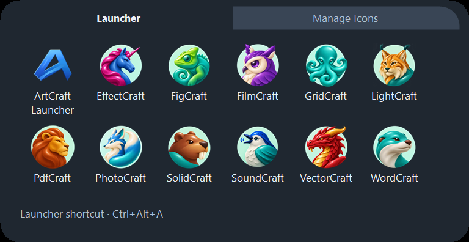
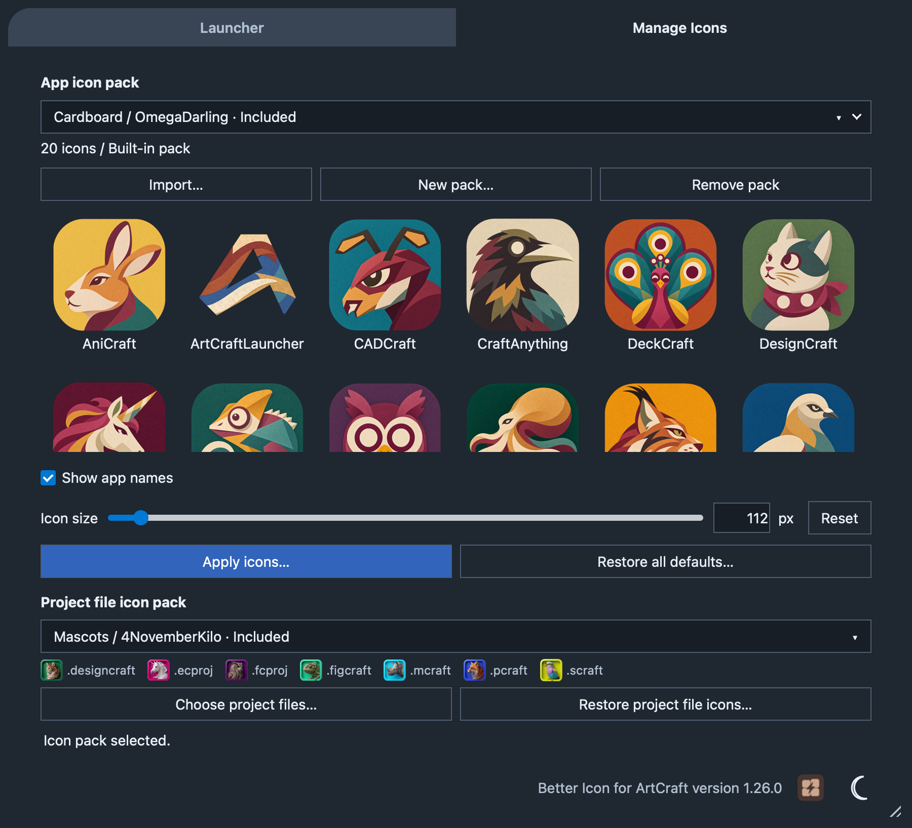
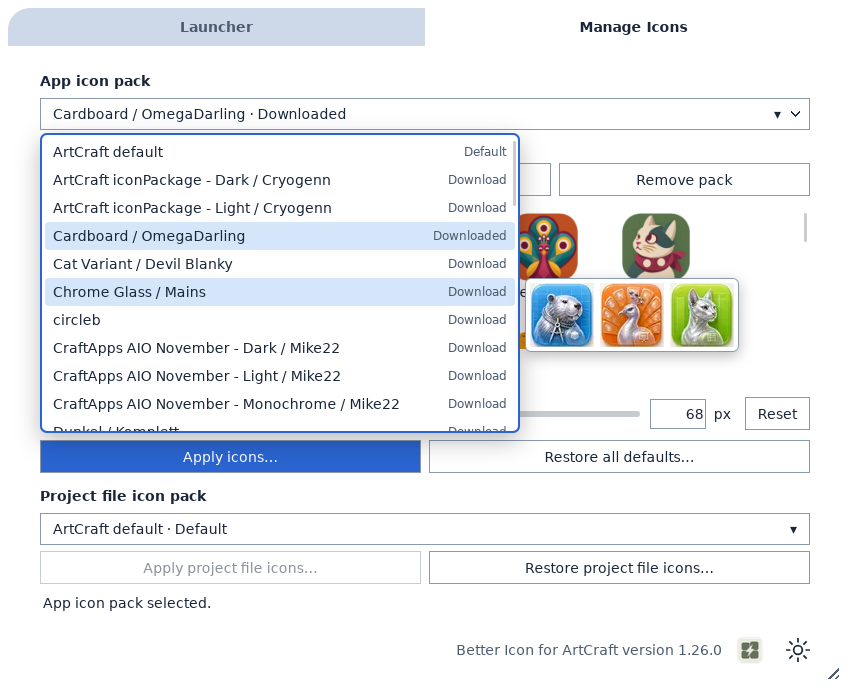

# BetterIcon for ArtCraft

BetterIcon puts your installed ArtCraft apps in one launcher, accessible from the Windows or Linux system tray and the macOS menu bar. You can give the apps a new set of icons and choose different artwork for their project files.

**[Download BetterIcon 1.26.3 for Windows, macOS, or Linux](https://github.com/BinziiBinzet/bettericon-craft-apps/releases/tag/v1.26.3)**. Each platform has two editions, with SHA-256 checksums on the release page.

- **Bundled** includes all 32 icon packs and their previews, ready for offline use.
- **On-demand** starts with the pack list and downloads the full artwork when you select a pack.

## BetterIcon in action

### Launch an app from the keyboard

Press your launcher shortcut, type the first few letters of an app name, and press **Enter** or **Return**. In the Windows example below, typing `fil` selects FilmCraft from a grid of **HyGel** icons by OmegaDarling. You can also double-click a tile. To change the shortcut, click it in the lower-left corner.

Each tab remembers its window size. You can keep **Launcher** compact and give **Manage Icons** more room. The divider stays in place when you switch. The tray or menu bar icon opens the larger tab (Launcher on a tie), and the keyboard shortcut always opens Launcher.

### Choose different icons for apps and project files

In **Manage Icons**, pick an app pack to preview its artwork, then choose **Apply icons** to review the changes. The macOS example pairs OmegaDarling’s **Cardboard** app icons with **Mascots** by 4NovemberKilo for project files, including PhotoCraft’s `.pcraft` and SoundCraft’s `.scraft`.

On macOS, **Choose project files** lets you pick individual documents in Finder. On Windows and Linux, you can apply icons by project file type. You can restore the original app or file icons independently, or import your own artwork and share a personal pack as a ZIP.

### Preview a pack before downloading it

Hover over a pack name to see up to three sample icons. ArtCraft Launcher appears first when the pack includes it. In the Linux example, **Cardboard** is marked **Downloaded**, while **Chrome Glass** by Mains still says **Download** even with its preview open. Click the pack or press **Enter** to download its full artwork.

BetterIcon checks for new and updated icon packs at startup and about every 30 minutes while running. A small dot appears on the repeat-arrows button beside **App icon pack** in **Manage Icons** when there are changes. Click the button to refresh the list, then select the individual packs you want to download or update. **Refresh available icon packs** is also in the tray or menu bar icon’s right-click menu. The progress bar shows when artwork is downloading or loading from disk.

## Community icon packs

VimiummuimiV’s eight Modern Flat variations now appear as one 13-icon pack. If you used a former variant for apps or project files, BetterIcon 1.26.1 remembers that choice in the corresponding picker. Matching downloads work offline immediately. If your cached artwork differs, you can keep using it until you select **Modern Flat** to download the update. [Modern Flat artwork and sources](Craft-Icons-VimiummuimiV/)

The nine themes in [Craft-Icons-OmegaDarling](Craft-Icons-OmegaDarling/) are by **OmegaDarling**. All include ArtCraft Launcher. Edgework and Foldmark each contain 21 icons. Existing `Craft-Icons-Zach` theme IDs remain compatible.

The selected ArtCraft Discord artwork is organized by the posting creator. Each style folder contains app-named PNGs and a BetterIcon pack description. The folders can be imported individually in Manage Icons.

| Creator | Collection |
| --- | --- |
| 𝕸𝖆𝖎𝖓𝖘 | [Five styles](Craft-Icons-Mains/) |
| kristofp | [Engraved Animals](Craft-Icons-kristofp/) |
| circleb | [Existing icons and Origami Animals](Craft-Icons-circleb/) |
| 4NovemberKilo | [Mascots](Craft-Icons-4NovemberKilo/) |
| kOdeNeRA | [Minimal Symbols](Craft-Icons-kOdeNeRA/) |
| หมาแดนซ์ | [Mascots](Craft-Icons-%E0%B8%AB%E0%B8%A1%E0%B8%B2%E0%B9%81%E0%B8%94%E0%B8%99%E0%B8%8B%E0%B9%8C/) |
| Devil Blanky | [Mascots and Cat Variant](Craft-Icons-Devil%20Blanky/) |
| VimiummuimiV | [Modern Flat](Craft-Icons-VimiummuimiV/) |
| Cryogenn | [ArtCraft iconPackage](Craft-Icons-Cryogenn/) |
| Mike22 | [CraftApps AIO November](Craft-Icons-Mike22/) |

The circleb Origami Animals set is a separate import ZIP in the existing circleb folder. VimiummuimiV and Mike22 also supplied file-type artwork, which is preserved in their source archives.

Credits, source links, inferred app assignments, and artwork notes appear in each creator folder.

## Supported Applications

BetterIcon recognizes the official ArtCraft apps, including ArtCraft Launcher, FilmCraft, PhotoCraft, PdfCraft, SoundCraft, and VectorCraft. The Launcher tab shows the ones installed on your computer.

## How to Run

### Linux

- Extract the graphical Linux package and run `./install.sh` to add **BetterIcon for ArtCraft** to Applications and the system tray. Press **Ctrl+Alt+A** to open Launcher. [Linux guide](Linux/README.md)
- The original terminal installer, `Linux/install.sh`, reports which apps it finds and backs up their desktop entries. Run `Linux/uninstall.sh` to restore them. The scripts support KDE Plasma, GNOME, Cinnamon, XFCE, i3, and Hyprland.

### Windows

- Run either Windows installer to add BetterIcon and its Start menu shortcut. Click the tray icon to open or close the popup. A source checkout also includes `Windows/Start-Tray.cmd`.
- **Restore original icons** restores the saved shortcuts. Shared shortcuts request administrator access only when applying or restoring.
- Share personal packs with **Manage Icons → Export ZIP**. Recipients use **Import ZIP** to load the artwork and its credits.
- The command-line installers remain available as `Windows/Install-Windows.cmd` and `Windows/Restore-Windows.cmd`.
- Windows PowerShell and .NET Framework are included with supported Windows installations; no Python or downloaded modules are required.
- For supported themes, backups, and taskbar limitations, read [WINDOWS.md](Windows/WINDOWS.md).

### macOS

- Open the BetterIcon disk image and drag **BetterIcon** into Applications. Open it once to add the menu bar icon.
- In **Manage Icons**, choose a pack and click **Apply icons…**. Review the application paths before applying. **Restore all defaults…** restores their original icons. [Mac guide](macOS/README.md)

## Contributing & Forking

This project is open source, and you are free to fork it for personal use or customization. 

However, if you have improvements, bug fixes, or new features, we strongly encourage you to contribute back to the main repository via Pull Requests instead of maintaining separate forks. This helps keep the ecosystem unified and makes it easier for everyone to benefit from updates.

### Adding New Themes
If you want to contribute a new icon theme, please submit a Pull Request. Ensure that the icon filenames follow the standard naming convention (e.g., `EffectCraft.png`, `PhotoCraft.png`) so the installer can detect and apply them correctly.

## Important Notes

The following notes apply to the Linux installer. Windows behavior is documented separately in [WINDOWS.md](Windows/WINDOWS.md).

- Icon files must contain the app name in their filename (case-insensitive matching).
- Logout/login is recommended after installation for full effect on all Desktop Environments.
- Original `.desktop` files are automatically backed up to `~/.local/share/applications/bettericon-backup/`.
- Currently tested and optimized for Linux distributions (Arch, Fedora, Ubuntu, Debian, etc.).

## License

MIT © BinziiBinzet. See [LICENSE](LICENSE) for details.
