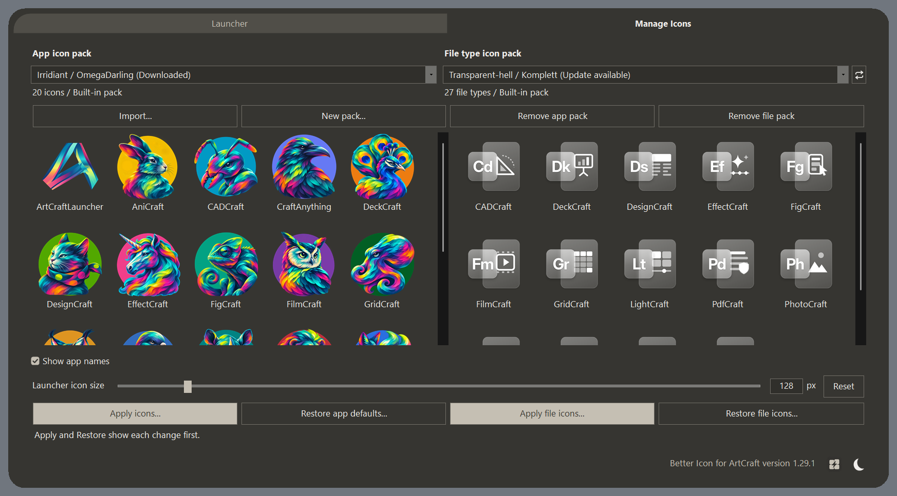
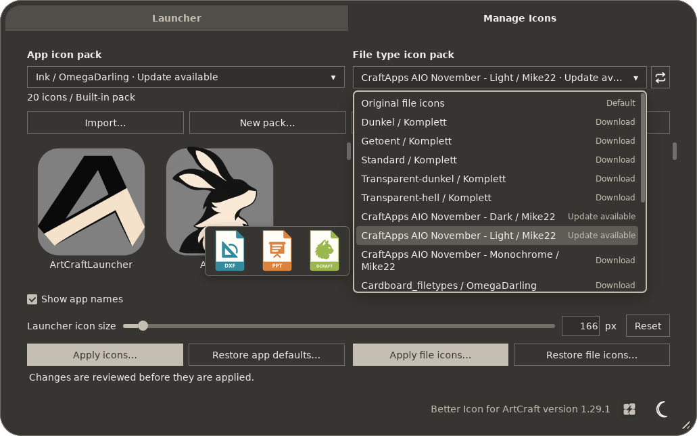
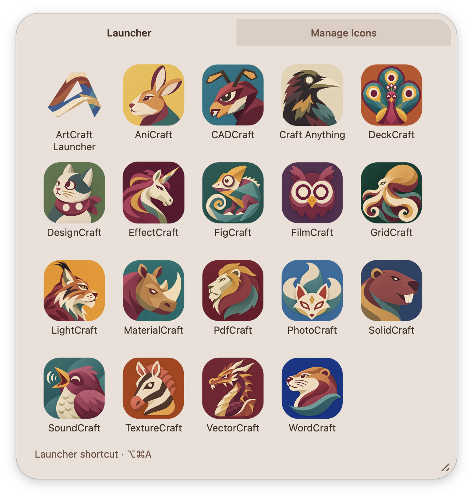
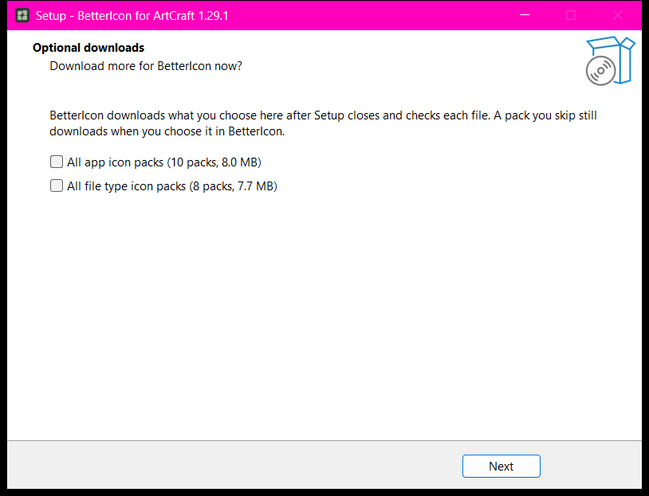

# BetterIcon for ArtCraft

Launch your installed ArtCraft apps from the Windows or Linux system tray or the macOS menu bar. Give your apps and their files different looks with independent icon packs.

**[Download BetterIcon for Windows, macOS, or Linux](https://github.com/BinziiBinzet/bettericon-craft-apps/releases/latest)**

The screenshots and features below are from **BetterIcon 1.29.1**. To make your own icons, read the [Community Guide (PDF)](docs/community/making-icons-for-artcraft.pdf) and try the [Daybreak starter pack](docs/community/daybreak-starter-pack.zip?raw=true).

## BetterIcon in action

### Pick separate app and file type icons

Open **Manage Icons** and choose an **App icon pack** and a **File type icon pack**. The two previews sit side by side. Choose **Apply icons…** or **Apply file icons…** to review and apply the artwork. Use **Restore app defaults…** and **Restore file icons…** to undo either change independently.

*Windows Manage Icons with Irridiant by OmegaDarling and Transparent-hell by Komplett.*

### Customize the icons for your files

BetterIcon recognizes **37 file icon designs covering 96 extensions**, from native ArtCraft projects to groups of related formats. A pack can give PhotoCraft projects (`.pcraft`) their own icon and use one design for Photoshop documents (`.psd` and `.psb`). Pack authors can also provide artwork for unlisted types that open by default in an ArtCraft app. Applying icons keeps your default apps in place.

- **Windows** applies one icon per file class in File Explorer. An ArtCraft app’s class qualifies for catch-all artwork when it is the default for at least one unlisted extension and no listed extension. If the class also opens a listed type by default, that type’s icon rules apply to the whole class.
- **Linux** applies icons per MIME type for your account. Artwork for other file types applies to eligible MIME types that no listed extension uses. BetterIcon removes the icon when the default opener moves away from the ArtCraft app and brings it back if the app becomes the default again. Press **F5** to refresh an open GNOME Files window. File managers may still show content thumbnails.
- **macOS** applies custom Finder icons to the files you select or to matching files in folders you choose to keep up to date. BetterIcon checks new and changed files while it runs and catches up at the next launch. For unlisted types, BetterIcon uses each file’s opener, including its **Open with** setting in Get Info. Listed types can use their pack artwork with any opener. **Restore file icons…** covers these icons too. Restoring a folder also stops watching it.

On Windows and Linux, listed common formats such as PDF generally qualify when an ArtCraft app is the default opener. Review the affected types before applying.

*Linux preview of the Light edition of Mike22’s CraftApps AIO November file type pack.*

### Preview packs before downloading

Hover over a name in either picker to see up to three sample icons. **Download**, **Downloaded**, and **Update available** show the status of each pack. Select a pack to download or update its artwork. Click the refresh button beside the pickers to check for catalog changes. The installer includes the catalog and its hover previews.

### Launch apps with one click

Open **Launcher** from the tray or menu bar, or use the configurable keyboard shortcut. Click an app to open it, or type part of its name and press **Enter** or **Return**. The icon brightens when you hover over it or select it with the keyboard. Launcher shows the last applied app pack, with ArtCraft Launcher first when installed. The two tabs remember their window sizes separately. You can also change icon size, show or hide app names, and choose BetterIcon’s own icon and light or dark appearance.

*macOS Launcher with Cardboard by OmegaDarling.*

### Keep your app icons after updates

BetterIcon puts your icons back when an ArtCraft app or ArtCraft Launcher update replaces them. New ArtCraft apps also get your applied pack automatically. On Windows this covers shortcuts created by the app’s installer, on macOS it covers locations included in your last **Apply icons…**, and on Linux it covers new app menu entries.

## How to Run

Each platform has one installer. BetterIcon downloads pack artwork as you choose it and keeps the downloaded packs available offline. [GitHub Releases](https://github.com/BinziiBinzet/bettericon-craft-apps/releases)

Windows Setup’s **Optional downloads** page lets you request all app icon packs, all file type icon packs, or both. It also offers **WebP support** on PCs that need it. BetterIcon downloads your selections in the background after Setup. On a new macOS or Linux installation, BetterIcon offers the two pack collections once at first launch. **Not now** leaves the packs available for individual download.

### Linux

- Extract the graphical Linux package and run `./install.sh` to add **BetterIcon for ArtCraft** to Applications and the system tray. It starts in the tray when you log in. [Linux guide](Linux/README.md)
- The original terminal installer, `Linux/install.sh`, reports which apps it finds and backs up their desktop entries. Run `Linux/uninstall.sh` to restore them.

### Windows

- Run Windows Setup to add BetterIcon and its Start menu shortcut. Click the tray icon to open or close the popup. A source checkout also includes `Windows/Start-Tray.cmd`.
- BetterIcon fixes shared shortcuts automatically after updates when Windows grants administrator access without a prompt. Otherwise, choose **Apply your icons to shared shortcuts…** in **Manage Icons** or the tray menu to approve the repair once.
- The installed app starts hidden in the tray at login by default. Turn it off with **Open at login** in the tray menu or in **Settings > Apps > Startup**. The command-line installers remain available as `Windows/Install-Windows.cmd` and `Windows/Restore-Windows.cmd`. [Windows guide](Windows/WINDOWS.md)

*This PC was missing 10 app packs and 8 file type packs. Setup counts the packs still to download.*

### macOS

- Open the disk image, drag **BetterIcon** into Applications, then open it. On macOS 13 and later, BetterIcon starts in the menu bar at login by default. Use **Open at Login** in the menu bar icon’s right-click menu or manage it in **System Settings > General > Login Items & Extensions** (**Login Items** on macOS 13 and 14).
- In **Manage Icons**, choose an app icon pack and click **Apply icons…**. Review the application paths before applying. If macOS blocks an icon change, enable BetterIcon under **System Settings > Privacy & Security > App Management**, then quit and reopen it. **Restore app defaults…** restores the original app icons. Choose a file type pack beside the app pack to change file icons. [Mac guide](macOS/README.md)

## Make an icon pack

The **BetterIcon Community Guide** covers small-icon design, artwork names, WebP, app-level file artwork, ZIP packaging, and testing. It maps the 96 listed extensions to their 37 artwork keys. [Read the Community Guide PDF](docs/community/making-icons-for-artcraft.pdf)

Try a working example with a PhotoCraft app icon and a matching project-file icon. In **Manage Icons**, choose **Import…** and pick the ZIP. [Download the Daybreak starter pack](docs/community/daybreak-starter-pack.zip?raw=true)

### Name your artwork

Put app icons at the top level, such as `PhotoCraft.png`, and document icons in `FileTypes/`, such as `FileTypes/pcraft.png`. For a group, use its listed artwork key. For example, `FileTypes/obj.png` covers `.obj`, `.fbx`, `.gltf`, and the other extensions in the OBJ group. An “OBJ” badge drawn into that image appears on FBX files too. A mesh or 3D model symbol works across the group.

To supply a catch-all, add `FileTypes/TextureCraft-files.png`. It fills in TextureCraft’s listed groups that lack their own design and covers eligible unlisted types that open in TextureCraft by default. The same rule works for other apps. On a Mac where VectorCraft opens `.afdesign`, a selected `.afdesign` file can use `FileTypes/VectorCraft-files.png`.

Use the original `<App>-files` name for every artwork format you supply. BetterIcon accepts one ASCII space, underscore, period, or hyphen before `files`. Capitalization is flexible. A legacy filename such as `FileTypes/PhotoCraft-PSD.png` supplies artwork only under the listed-format rules. Exporting and reimporting a personal pack preserves its catch-all.

### Choose an image format

Artwork may be PNG, WebP, SVG, or ICO. Name WebP files like PNG files, for example `PhotoCraft.webp`, `FileTypes/pcraft.webp`, or `FileTypes/TextureCraft-files.webp`. BetterIcon 1.28.0 and later prefer WebP when a pack has both WebP and PNG for the same icon. Keep the matching PNG for earlier versions. WebP artwork must be still, at most 4,096 pixels per side, and no larger than 16 MB. Use lossless WebP for transparency, keep previews and source sheets outside the pack folder, and supply only one image per icon in each format.

BetterIcon falls back to a matching PNG when a WebP cannot be used. If there’s no usable artwork, the status line reports the skipped icon and why. On macOS, a damaged WebP with an intact header can appear blank if the system decoder accepts it. Personal imports store WebP artwork as PNG for sharing. On Windows, **Install WebP support** is available in the tray menu when needed. Applying icons for all users uses Windows’ own WebP decoder or the matching PNG.

Export personal packs as ZIPs to share them, or submit your artwork in a pull request with creator credits and any relevant source links.

## Community icon packs

The catalog has 41 community packs. The nine OmegaDarling styles each include 20 app icons and a matching pack of 37 file icon designs with hover previews. Most icons also come as a lighter WebP copy, at most 1,024 pixels per side. BetterIcon 1.29.0 and later download one file per icon, the WebP where the computer can read it and the PNG otherwise. With WebP, all the packs together are about 44 MB in place of 433 MB. The published packs have yet to opt in to unlisted file types. [Browse OmegaDarling’s artwork](Craft-Icons-OmegaDarling/)

Existing `Craft-Icons-Zach` theme IDs remain compatible.

| Creator | Collection |
| --- | --- |
| 𝕸𝖆𝖎𝖓𝖘 | [Five styles](Craft-Icons-Mains/) |
| kristofp | [Engraved Animals](Craft-Icons-kristofp/) |
| circleb | [Existing icons and Origami Animals](Craft-Icons-circleb/) |
| 4NovemberKilo | [Mascots](Craft-Icons-4NovemberKilo/) |
| kOdeNeRA | [Minimal Symbols](Craft-Icons-kOdeNeRA/) |
| หมาแดนซ์ | [Mascots](Craft-Icons-%E0%B8%AB%E0%B8%A1%E0%B8%B2%E0%B9%81%E0%B8%94%E0%B8%99%E0%B8%8B%E0%B9%8C/) |
| Devil Blanky | [Mascots and Cat Variant](Craft-Icons-Devil%20Blanky/) |
| VimiummuimiV | [Modern Flat](Craft-Icons-VimiummuimiV/) |
| Cryogenn | [ArtCraft iconPackage](Craft-Icons-Cryogenn/) |
| Mike22 | [CraftApps AIO November](Craft-Icons-Mike22/) |
| Komplett | [Five file type icon packs](Craft-Icons-Komplett/) |

The circleb Origami Animals set is available as an import ZIP. VimiummuimiV’s Modern Flat combines the eight earlier variants into one 13-icon pack.

Code fixes and improvements are welcome through pull requests.

## License

MIT © BinziiBinzet. See [LICENSE](LICENSE) for details.
